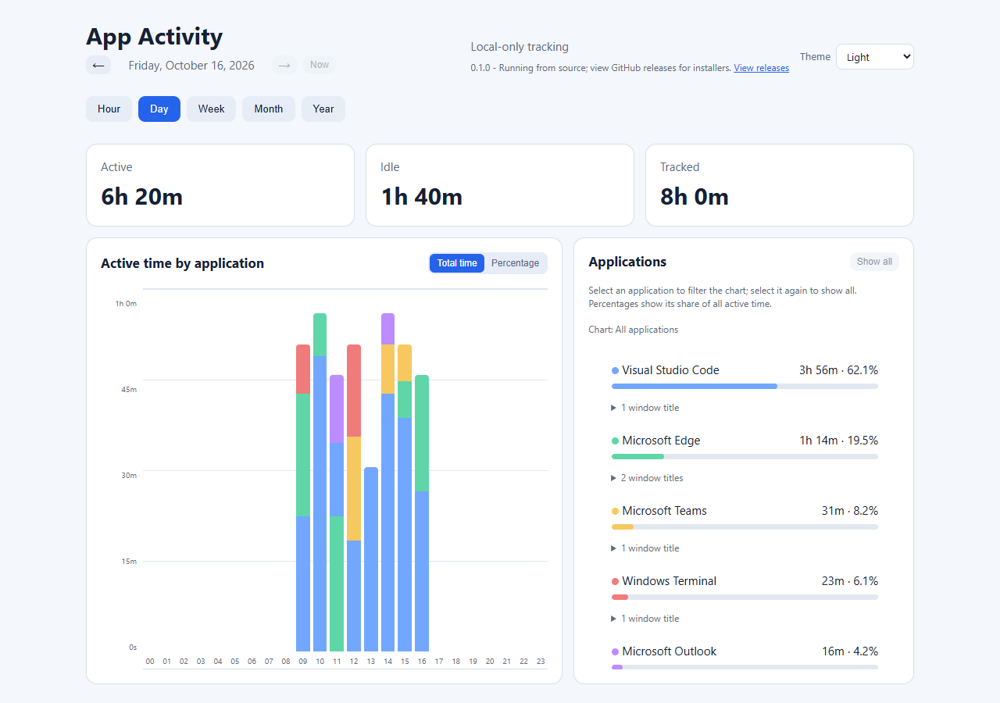
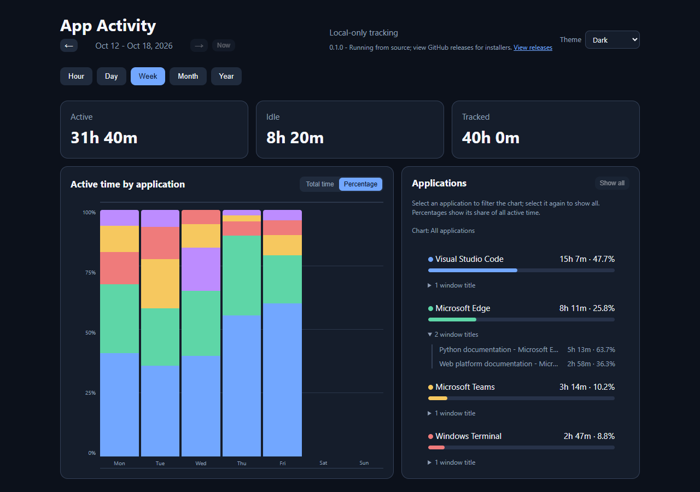
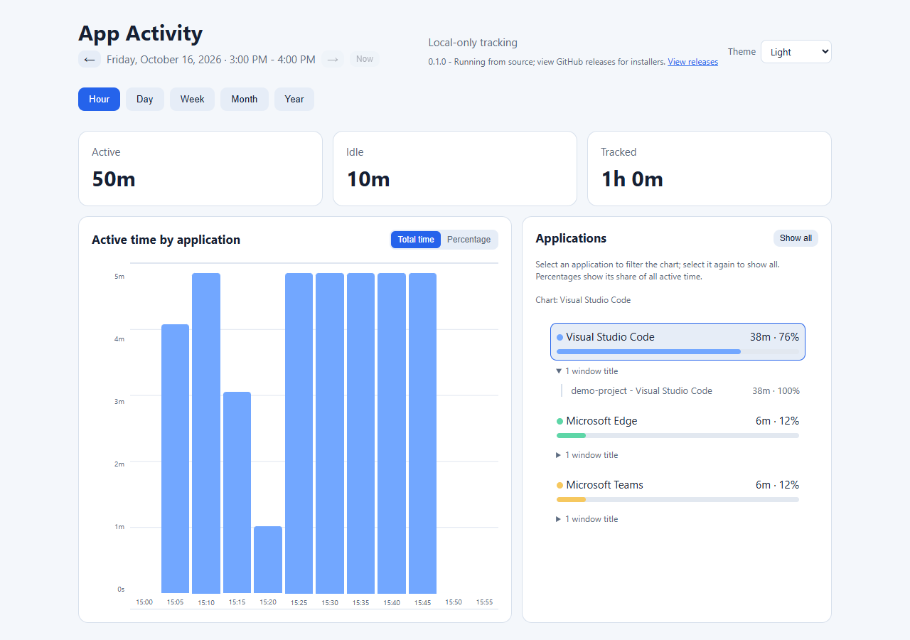

# App Activity

[](https://github.com/acangialosi/app-activity/releases/download/nightly/AppActivity-Setup.exe)
[](https://github.com/acangialosi/app-activity/actions/workflows/windows-installer.yml)
[](https://github.com/acangialosi/app-activity/actions/workflows/test-status.yml)

A lightweight, local-only Windows activity tracker. It records which application
has the foreground window, separates active time from idle time, and provides
hour, day, week, month, and year views in a local browser dashboard.

## Screenshots

These screenshots use synthetic demo activity, not personal tracking history.

### Daily overview

See active, idle, and total tracked time alongside an hourly breakdown by
application.



### Weekly trends and dark mode

Compare each application's share of active time across the week. Expand an
application to see time spent in individual window titles or browser pages.



### Focus on one application

Select an application to filter the chart without changing the report totals.
The hour view shows five-minute buckets, with window-title details alongside.



## Privacy and performance

- All history stays in `%LOCALAPPDATA%\AppActivity\activity.db`.
- Application Product Names, active window titles, and timestamps are stored.
  Window titles can include document names, browser page titles, email subjects,
  or other content displayed in a title bar. Typed text, screenshots, and
  document contents are never collected.
- The optional, read-only MCP server is App Activity's only built-in AI agent
  integration, and only agents you add it to can call it. Agents usually send
  what they retrieve to their model provider. Adding or removing the server
  doesn't control other access: while App Activity is tracking, any program on
  this PC can read history from the dashboard at `http://127.0.0.1:8765`, which
  doesn't require sign-in, and programs running as you can open `activity.db`.
  That includes agents that can fetch URLs, run commands, or read files. See
  [Use with AI agents (MCP)](#use-with-ai-agents-mcp).
- Historical process-name entries are automatically merged into their resolved
  application display name when that application is next observed.
- Reports aggregate time by Product Name and provide expandable per-window-title
  details beneath each application.
- Non-browser applications group changing titles by their stable Windows window.
  Browsers group by window and active page title so tab usage remains distinct.
- The activity chart uses consistent per-application colors and can switch
  between absolute time and percentage-of-bucket views.
- Click an application in the Applications list to show only it; click the sole
  selected application again to show all. **Ctrl+click** adds or removes an
  application from the chart selection; removing the last or choosing **Show all**
  clears the filter. Window-title details expand separately, and report totals
  remain unchanged. Selections stay in place when navigating periods or refreshing
  data, including applications with no activity in a period; percentage mode
  shows each application's share of all active time in each bucket.
- On desktop, the dashboard fits the browser height down to 720 pixels, with
  the application list scrolling within its panel. Shorter windows scroll the
  page; narrow screens retain the stacked layout.
- Open the **Settings** gear icon in the dashboard header for **Appearance**,
  **Export**, **Updates**, and **Feedback**.
  Choose a light or dark theme, or follow the Windows theme; the preference is
  saved in the browser. Settings works with keyboard Enter/Space and Tab;
  Escape closes it and returns focus to Settings. Clicking or tabbing outside
  also closes it. On narrow screens, the sections expand inline.
- Previous and next controls navigate by the selected hour, day, week, month,
  or year period without mixing data between reporting windows. The segmented
  **Hour / Day / Week / Month / Year** controls sit below navigation on the right,
  sharing its left and right edges, with **Settings** separately alongside on
  desktop. Narrow screens wrap the date controls and stack Settings above the
  full-width period controls.
  **Today** (or **This hour/week/month/year**) returns the selected view to its
  current period; it and the next arrow are disabled when already current.
  The calendar icon labels the displayed period, not a date picker. The hour view uses five-minute
  timeline buckets. Periods follow local calendar dates, so a day lasts 23 or
  25 hours when daylight saving time starts or ends.
- Open **Settings → Export** to export activity segments to CSV. Choose
  **From** and **To** dates, then **Export CSV**, or use **Export all** for all
  recorded history. Dates default to the displayed report's date range;
  custom dates stay unchanged during refreshes of that same report.
- The collector samples every five seconds and uses Windows APIs plus SQLite.
- You are considered idle after five minutes without keyboard or mouse input.
- The Windows lock screen, sign-in and credential surfaces, Windows desktop,
  display-off periods, and long sampling gaps across sleep or hibernation are
  classified as idle rather than application usage.
- A dedicated chart icon in the Windows system tray shows when tracking is
  running. Click it to open the usage report; right-click it to open or exit.
- Packaged builds check GitHub for updates while the dashboard is open.
  Successful checks are cached for an hour; failed checks retry after five
  minutes. An **Update available** badge stays visible on Settings even when
  collapsed; open **Updates** for the release link and **Check now**.
  **View releases** remains available there when no update is detected. Checks send no activity data,
  require no account or extra service, and do not interrupt tracking when offline.
  GitHub receives the usual download request metadata, including your IP address.

## Feedback

Open the **Settings** gear icon in the dashboard header, then choose
**Report a problem** or **Suggest a feature** under **Feedback**
to open a prefilled issue for this repository in a new GitHub tab. Sign in to
GitHub if needed, replace the suggested title, fill in the prompts, and review
your text before submitting. Nothing is submitted automatically, and no activity
history, window titles, or database contents are attached. Issues are public:
omit private information from anything you enter or upload.

## Install

### Windows installer

**[Download the latest App Activity installer](https://github.com/acangialosi/app-activity/releases/download/nightly/AppActivity-Setup.exe)**

The installer includes the Python runtime, installs for the current user, and
starts App Activity automatically at sign-in.

### Run from source

Python 3.11 or newer is required. From the repository folder, run:

```powershell
.\app_activity.cmd install
.\app_activity.cmd dashboard
```

`install` registers App Activity under the current user's Windows sign-in startup
and starts it immediately. The dashboard is available only on this machine at
<http://127.0.0.1:8765>.

## Commands

```powershell
.\app_activity.cmd dashboard
.\app_activity.cmd status
.\app_activity.cmd start
.\app_activity.cmd stop
.\app_activity.cmd install
.\app_activity.cmd uninstall
.\app_activity.cmd uninstall --delete-data
.\app_activity.cmd mcp
```

Uninstalling preserves history unless `--delete-data` is included.

`mcp` runs the read-only server that AI agents start on demand; you don't need
to run it yourself. See [Use with AI agents (MCP)](#use-with-ai-agents-mcp).

### Packaged Windows installer

Release builds provide `AppActivity-Setup.exe`, a per-user installer that
includes the Python runtime and requires no separate Python installation. It
installs under `%LOCALAPPDATA%\Programs\AppActivity`, registers sign-in startup,
adds Start Menu shortcuts, and preserves activity history during uninstall.
Every push to `main` replaces the installer in the rolling `nightly` prerelease.
Pushing a `v*` tag creates a permanent versioned GitHub Release. Manual workflow
runs produce a downloadable Actions artifact retained for one day without
creating a release. Every push and pull request must pass the test suite before
the installer is built, and publishing occurs only after both jobs succeed.

Updates are downloaded and installed manually; the app never downloads or runs
an installer automatically. Open **Settings → Updates** and select **Check now** beside the update
status to check immediately, without waiting for the cached result to expire.
The button is disabled while checking and for builds without update metadata.
Nightly installations follow the rolling `nightly`
release, and tagged builds follow GitHub's latest stable release. Each installer
bundles a build timestamp, also published as `AppActivity-update.json`, so nightly
updates are detected even without a version-number change. Older or identical
build timestamps do not trigger a notification. Source checkouts show a release
link without checking for installer updates. Update checks require a release
published with this metadata; older installations need a one-time manual upgrade
to gain the notification.

To build the installer:

```powershell
winget install JRSoftware.InnoSetup
.\build.ps1
```

The output is `artifacts\AppActivity-Setup.exe`. Set
`SIGNING_CERTIFICATE_PATH` and optionally `SIGNING_CERTIFICATE_PASSWORD` to
Authenticode-sign the application and installer during the build.

## Use with AI agents (MCP)

App Activity includes an optional, read-only
[Model Context Protocol](https://modelcontextprotocol.io/) (MCP) server that
lets AI agents on this machine answer questions about your activity history.
MCP-capable agents, such as GitHub Copilot CLI, VS Code, and Claude Code,
start the server on demand and communicate with it over standard input and
output.

- It opens no network port and never starts the tracking service.
- It reads existing history without creating or changing it, whether or not
  tracking is running. The `get_tracking_status` tool reports whether App
  Activity is currently recording.
- It supports MCP protocol revisions 2024-11-05 through 2026-07-28.
- Nothing is shared until you add the server to an agent.

Configure each agent with the command for your installation:

- **Windows installer:** `AppActivity.exe` with the argument `mcp`. Setup
  installs it in `C:\Users\<you>\AppData\Local\Programs\AppActivity` unless
  you chose another folder. No window appears when an agent starts it.
- **Source checkout:** `python` with the arguments
  `C:\path\to\app-activity\app_activity_launcher.py` and `mcp`. This works
  from any working directory. If an agent can't find `python`, use the full
  path to `python.exe` for Python 3.11 or newer.

Write out full paths, because agents don't reliably expand Windows variables
such as `%LOCALAPPDATA%`. This command prints the default installed path as a
JSON string:

```powershell
Join-Path $env:LOCALAPPDATA 'Programs\AppActivity\AppActivity.exe' | ConvertTo-Json
```

### GitHub Copilot CLI

Add the server to `%USERPROFILE%\.copilot\mcp-config.json`, or to
`mcp-config.json` in the `COPILOT_HOME` folder if that variable is set. Create
the file if it doesn't exist; otherwise, add the `app-activity` entry to its
`mcpServers` object:

```json
{
  "mcpServers": {
    "app-activity": {
      "type": "stdio",
      "command": "C:\\Users\\<you>\\AppData\\Local\\Programs\\AppActivity\\AppActivity.exe",
      "args": ["mcp"],
      "tools": ["*"]
    }
  }
}
```

For a source checkout, use `"command": "python"` and
`"args": ["C:\\path\\to\\app-activity\\app_activity_launcher.py", "mcp"]`.
Run `copilot mcp list` to check the entry. You can also add the server
interactively with `/mcp add` in a Copilot CLI session.

### VS Code

VS Code reads the Copilot CLI file above by default, so the same entry works
in both. VS Code's own `mcp.json` format, kept for compatibility, uses a
top-level `servers` object instead. To use it, run
**MCP: Open User Configuration** for your user profile's file, or edit
`.vscode\mcp.json` in a workspace:

```json
{
  "servers": {
    "app-activity": {
      "type": "stdio",
      "command": "C:\\Users\\<you>\\AppData\\Local\\Programs\\AppActivity\\AppActivity.exe",
      "args": ["mcp"]
    }
  }
}
```

Add App Activity to one format or the other, not both. Run
**MCP: List Servers** to check the server.

### Claude Code

```powershell
$exe = Join-Path $env:LOCALAPPDATA 'Programs\AppActivity\AppActivity.exe'
claude mcp add --transport stdio --scope user app-activity -- $exe mcp
```

Adjust `$exe` if you installed elsewhere. `--scope user` makes the server
available in all your projects; without it, Claude Code adds it to the current
project only. For a source checkout, replace `$exe mcp` with
`python C:\path\to\app-activity\app_activity_launcher.py mcp`. Run
`claude mcp get app-activity` to check the connection.

### Tools

Agents call these tools to answer questions such as "Which applications did I
use most this week?"

| Tool | Returns | Main parameters |
| --- | --- | --- |
| `get_activity_summary` | Active and idle totals and top applications for one hour, day, week, month, or year, with an optional timeline | `period` (`hour`, `day`, `week`, `month`, or `year`; default `day`), `date` (default now), `include_timeline`, `include_window_titles`, `max_applications` (1-100, default 20), `max_windows_per_application` (1-50, default 10) |
| `get_activity_segments` | Chronological foreground-application segments in a time range of up to 31 days, clipped to the range | `start` and `end` (required), `application` (exact name, any case), `include_idle` (default `true`), `include_window_titles`, `limit` (1-1000, default 200), `offset` (default 0) |
| `get_tracking_status` | Whether App Activity is recording, whether history exists, the first and last recorded times, the current local time, time zone, and UTC offset, the sampling interval, and the idle threshold | None |

- Dates and times use ISO 8601 and are local unless they include a UTC offset
  or `Z`. `date` can be any date or date-time in the period; an `hour` period
  needs a time. Weeks start on Monday.
- A date-only `end` includes that whole day; a date-time `end` is exclusive.
- Timelines use five-minute buckets for an hour, hourly buckets for a day,
  daily buckets for a week or month, and monthly buckets for a year.
- Each period boundary uses the UTC offset in effect at that time, so a day
  lasts 23 or 25 hours when daylight saving time starts or ends. A local time
  without an offset in a repeated hour means its first occurrence.
- `include_timeline` and `include_window_titles` default to `false`.

### Privacy

- Tool results go to the agent and usually to its model provider.
- Window titles can include document names, browser page titles, and email
  subjects. Tools return them only when a call sets `include_window_titles` to
  `true`, which an agent can do on its own, so review tool calls when your
  client asks for approval.
- The server is read-only and bounded: segment queries cover at most 31 days,
  and results are limited and paginated. These limits don't restrict an
  agent's other tools. An agent allowed to read files or run commands could
  open `activity.db` directly, and one that can fetch URLs or run commands
  could read the dashboard at `http://127.0.0.1:8765` while App Activity is
  tracking.
- To revoke an agent's MCP access, remove the server from each agent's
  configuration, for example with `copilot mcp remove app-activity` or
  `claude mcp remove app-activity`.

## Development

```powershell
python -m unittest discover -s tests -v
```

When Node.js is available, the suite also runs the dashboard's JavaScript
behavior tests. It also starts the MCP server from the source checkout and
exercises it over standard input and output. To check a packaged build the same
way, run the following after `.\build.ps1`; CI runs it after building the
installer:

```powershell
python tools\mcp_smoke_test.py dist\AppActivity\AppActivity.exe mcp
```

### Repository security protections

No local security-tool installation or Git hook is required. GitHub Actions
scans fetched Git history with Betterleaks and audits committed Python
dependencies with pip-audit on Windows/Python 3.11-3.14. Required checks block
merging when findings or scanner failures occur. GitHub secret push protection,
secret scanning, Dependabot alerts, and CodeQL remain enabled.

These CI checks run after a push, not on your workstation. GitHub push
protection can reject supported secret patterns during a push.
See [Security checks](docs/security-checks.md) for coverage, remediation,
limitations, and cleanup instructions for older clones.
